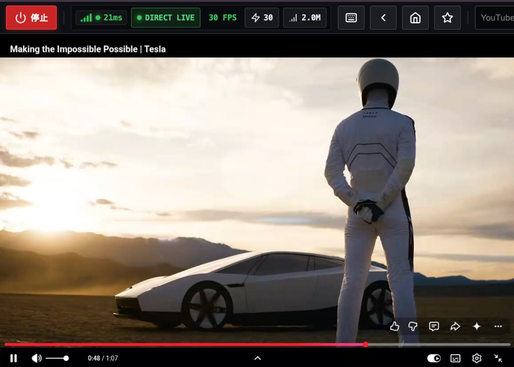
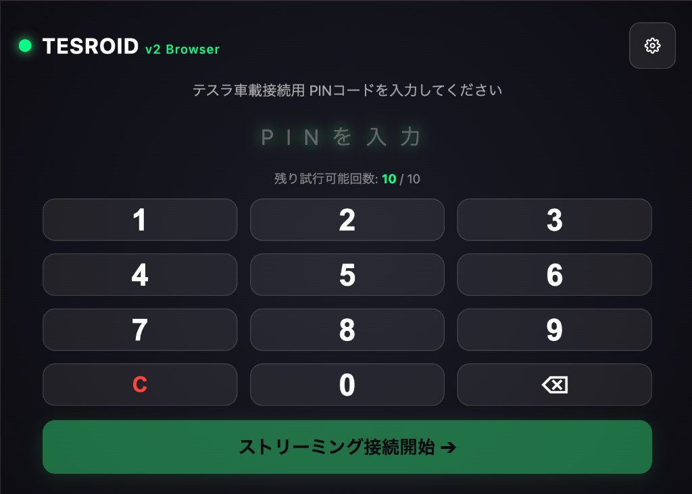
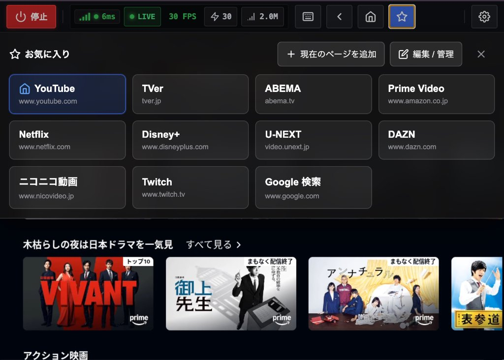

# Tesroid

**Tesla-Optimized Self-Hosted Cloud Browser Streaming System**

[](LICENSE)

自宅サーバー（Linux / NAS）上の Docker で動かした Google Chrome の画面と音声を、**テスラ車載ブラウザだけでそのまま視聴・タッチ操作できるセルフホスト型リモートブラウザ** です。

車に乗ったら純正ブラウザのブックマークを開くだけ。スマホを取り出したりテザリングを繋いだりする必要はなく、テスラのプレミアムコネクティビティ回線だけで、いつもの YouTube や動画サービスを車内ディスプレイで楽しめます。



---

## 何ができるアプリなのか（Tesroid の魅力）

Tesroid は「車内で気楽に・クリーンに・安定して動画を観たい」というニーズに振り切って設計されています。

1. **セルフホスト費用以外は完全無料**
   - オープンソース（MIT ライセンス）として公開されており、アプリの利用料・月額サブスク・広告などは一切ありません。
   - 自宅の Linux PC や NAS（＋必要に応じて年数ドル程度の独自ドメイン等）の維持費だけでずっと使い続けられます。
2. **動画視聴に特化 ＆ 電波悪化に強いバッファリング対応**
   - テスラ車載ブラウザの「走行開始（D/Rレンジ）で動画が止まる」制約を回避し、同乗者が走行中も動画や Web コンテンツの視聴を継続できます（※1）。
   - トンネルや郊外など通信状況が悪化しやすいドライブ中でも再生が途切れにくいよう、**最大 30 秒の先読みバッファリング ＆ 自動追っかけ再生** に対応。リアルタイムに戻したいときは画面上の **`LIVE`** ボタンひとつで即座に最新位置へ同期できます。
   - 前席・後席モニターの同時視聴や、片手で押しやすいお気に入り切り替え・YouTube 専用検索バーなど、車内操作に最適化した専用 HUD を備えています。
3. **使うときの特別なアプリ起動や面倒な操作はゼロ**
   - スマートフォンで専用アプリを起動したり、画面ミラーリング／キャストを繋ぎ直したりする手間は一切不要です。
   - 車両の純正ブラウザから自分のサーバー URL を開いて PIN を入力すれば、数秒で前回の続きから視聴できます。
   - ブラウザを閉じて車から離れれば、サーバーは自動で省電力スリープ（CPU/GPU 負荷 0%）に入るため、サーバー側の管理操作もいりません。
4. **スマホの通信量を使わない（プレミアムコネクティビティのみで完結）**
   - スマホのテザリングや Wi-Fi 共有を使わず、車両の純正ブラウザと自宅サーバーが直接通信します。
   - スマートフォンのデータ通信量（ギガ）やバッテリーを消費せず、テスラの **プレミアムコネクティビティ（プレコネ）の通信のみ** で完結します。
5. **著作権や公衆送信権を侵害しない完全にクリーンな仕組み**
   - 動画の再配信や海賊版、他者へコンテンツを公開する仕組みではありません。**自宅にある自分専用のブラウザ画面を、自分の車のディスプレイに映して操作する 1 対 1 のプライベートなリモート接続** であり、権利を侵害しないクリーンなソリューションです。
6. **YouTube 等のログイン情報をクラウドに出さない透明性**
   - 第三者のクラウドサーバーに Google / YouTube などのアカウント情報、Cookie、視聴履歴を預ける必要は一切ありません。
   - ログイン状態やブラウザ設定はすべて自分の手元のサーバー内（Docker ボリューム）だけで完結し、ソースコードもすべて公開されているため挙動が完全に透明です。接続時の PIN 認証や 10 回連続失敗時の自動緊急停止など、公開時のセキュリティ対策も備えています。

> [!NOTE]
> ※1 走行中の画面注視・操作はドライバー以外の同乗者のみが行ってください（詳細は末尾の「[安全運転に関する警告](#ライセンス--免責事項)」を参照）。

---

## どういう人に向いているのか

### こんな方におすすめです

- **上記の「重視するポイント」に共感できる方**
  - 「怪しい外部サービスやサブスクには頼りたくない」「ログイン情報をクラウドに渡したくない」「法的にクリーンな形で、無料かつストレスなく車内で動画を観たい」という考え方に共感いただける方。
- **スマホのテザリングや毎回の接続操作から解放されたい方**
  - 乗車するたびにスマホを操作して画面を飛ばすのではなく、車載ディスプレイ単体・プレミアムコネクティビティ回線だけでサッと完結させたい方。
- **ある程度のネットワーク / サーバー知識があり、自分で試してみたい方**
  - 自宅の Linux マシンやミニ PC、NAS などで Docker を動かしたり、Cloudflare Tunnel やリバースプロキシを使って自宅環境を HTTPS 公開したりする作業を試せる方（初心者向けの [かんたん導入ガイド](docs/QUICKSTART.md) も用意しています）。

### MCU2（Intel Atom 搭載車）でのデバッグ・最適化仲間を募集中

- 現状の Tesroid は **MCU3（AMD Ryzen 搭載車）** を中心に調整されており、Ryzen 環境では 30/60fps で快適に動作します。
- 一方で **MCU2（Intel Atom 搭載車）** では車載ブラウザ側の処理性能が厳しく、現状どうしても動作が重くなってしまう場面があります（軽量 2 秒バッファ設定などの対策は用意していますが、実車でのチューニングがまだ十分ではありません）。
- **「MCU2 の実車でデバッグログを取ったり、さらなる軽量化・最適化を一緒に手伝ってもいいよ！」という稀有なオーナー様・開発者の方** のご参加を心よりお待ちしています。Issue での動作報告や Pull Request での改善提案をぜひお寄せください。

---

## 車載ブラウザでの操作方法 & ログイン手順

車載ブラウザからサーバーの URL を開くと、フルスクリーン PIN 認証画面が表示されます。4〜8 桁の PIN を入力して接続すると、そのまま自宅 Chrome の画面を利用できます。



テスラ車載ディスプレイ（15/17インチ）での快適な操作のために、画面上部に **常設 HUD（ヘッドアップディスプレイ）** を搭載しています。

```text
[ Top HUD ] ── [15ms] [LIVE] [60FPS] [2.0M] ── [キーボード] [戻る] [ホーム] [お気に入り] [YouTube検索...] [設定]
  │
  ├── (キーボードボタンをタップで展開)
  │    [ キーボードバー ] ── [ 入力欄 (テスラキーボード起動) ] [送信] [Enter] [BS] [Tab] [閉じる]
  │
  └── (お気に入りボタンをタップで展開)
       [ お気に入りドロワー ] ── [＋ 現在のページを追加] [編集 / 管理] [閉じる]
                              ── [YouTube (ホーム)] [Netflix] [ABEMA] ...
```

### 1. 基本操作 (タッチ & ナビゲーション)
- **タップ / スワイプ**: 画面内の動画サムネイルやボタンを直接タップ。上下にスワイプすると慣性スクロールします。
- **戻る / ホーム**: ブラウザ履歴を戻る、またはお気に入りで「ホーム」に設定したサイトへ瞬時にジャンプします（初期設定は YouTube）。
- **YouTube 検索バー**: YouTube 閲覧中のみ HUD 右側に自動表示され、入力して検索を実行できます。他サイト閲覧時は誤操作防止のため自動的に非表示になります。
- **LIVE ボタン**: ネットワーク一時途絶時の追っかけ再生バッファをスキップし、最新の低遅延ライブ配信へ強制同期します。
- **画質・レート切替**: `30 / 60 FPS`、`0.5M 〜 2.0M` ビットレートをワンタップで切り替え可能です。
- **先行バッファ深度 / 音質調整（設定ボタン）**: 走行環境に合わせて先行バッファ（オフ〜最大 30 秒）や音声ビットレート（128k〜320k）を調整できます。

### 2. お気に入り機能・ホーム設定の使い方
上部 HUD の **お気に入りボタン（星アイコン）** から、映像配信サービスやよく使うサイトへ 1〜2 タップで切り替えられます。



- **サイト切り替え**: お気に入りドロワーを開き、登録済みのサイトボタンを押すと即座に移動し、ドロワーは自動で閉じます。
- **閲覧中のページをお気に入りに追加**: ドロワー上部の **「＋ 現在のページを追加」** をタップすると、現在開いているページのタイトルと URL がそのまま登録されます。
- **お気に入りの編集・並び替え・ホーム変更**:
  - ドロワーの **「編集 / 管理」**（または HUD 右端の設定ボタン ➔ **「Webブラウザ」タブ**）から管理画面を開きます。
  - サイトの追加・編集・削除・上下の並び替え、**「ホームに設定」** の切り替え、**「初期プリセットに戻す」** が行えます。
  - 設定内容はサーバー側（`data/config.json`）に保存されるため、スマホや PC から事前登録したお気に入りをそのまま車内で利用でき、コンテナ起動時の初期ページも「ホーム」に設定したサイトと連動します（環境変数 `BROWSER_URL` 未指定時）。

### 3. Google / YouTube へのサインイン手順（文字入力方法）
テスラ車載ブラウザでは、映像キャンバスを直接タップしても車載キーボードが起動しない仕様となっています。サインインや検索は以下の手順で行ってください：

1. 画面上の **「Sign in (ログイン)」** ボタンをタップして Google ログイン画面を開きます。
2. 上部 HUD の **キーボードボタン** をタップして、キーボード入力バーを展開します。
3. 入力バーのテキスト欄をタップすると、**テスラ車載のソフトウェアキーボードが起動** します。
4. メールアドレスを入力し、**「送信」**（または **「Enter」**）を押すと、画面内の入力欄へ即座に入力されます。
5. **「次へ (Next)」** を押してパスワード入力画面へ進みます。
   > [!NOTE]
   > **パスキー（Passkey）が有効なアカウントの場合**:
   > 通常の Chrome では操作不能なパスキー選択ダイアログが出現しますが、Tesroid はこれを自動抑止します。画面内に **「別の方法を試す」** または **「パスワードを入力」** が表示されますので、パスワードを入力してサインインを完了してください。
6. パスワードも同様にキーボードバーから入力して **「Enter」** を押せばサインイン完了です。ログイン状態は永続化ボリュームに保存され、次回以降は自動ログインされます。

---

## 動作要件

- **アーキテクチャ**: `x86_64` (`amd64`) 専用
- **OS**: Linux (Ubuntu 20.04/22.04/24.04, Debian 11/12 等)、NAS OS (TrueNAS SCALE 等)
- **GPU**: VAAPI 対応 GPU（Intel 第6世代 Skylake 以降の統合 GPU Quick Sync Video、または AMD Radeon VAAPI）
  - ホスト上に `/dev/dri/renderD128` が存在すること
- **動作確認済み iGPU**:
  | GPU / iGPU | アーキテクチャ (世代) | VAAPI ドライバ | 動作確認状況 | 備考 |
  | :--- | :--- | :--- | :--- | :--- |
  | **Intel UHD Graphics 630** | Coffee Lake (第8/9世代 Core) | `iHD` | 動作確認済み | 開発基準環境（1280x720@30/60fps 安定動作） |
  | **Intel UHD Graphics 600** | Gemini Lake (Celeron 等) | `iHD` | 動作確認済み | 省電力 iGPU 環境（[#46](https://github.com/RanasGenoa/Tesroid/issues/46) のパフォーマンス調整・軽量プリセット等により安定動作） |
- **メモリ**: 2 GB 以上推奨
- **ソフトウェア**: Docker Engine 24.0+ および Docker Compose v2.0+
- **ネットワーク**: テスラ車載ブラウザから接続する場合は **公的 CA による HTTPS (SSL/TLS) 環境** が必須です（詳細は [docs/NETWORK.md](docs/NETWORK.md) を参照）
- **車両環境**: MCU3（AMD Ryzen 搭載車）推奨。MCU2（Intel Atom 搭載車）は動作が重くなるため実験的サポート（デバッグ・最適化協力者を募集中）

### 非対応・非推奨環境

Tesroid は低遅延・省リソースを実現するため、ハードウェア支援エンコード（VAAPI）と `amd64` 環境を前提としています。以下の環境は非対応または非推奨です：

| 環境 | 対応状況 | 主な理由 |
| :--- | :---: | :--- |
| **格安 VPS / GPU なしクラウド VM** | 非対応 | 映像エンコードに `h264_vaapi`（`/dev/dri/renderD128`）が必須であり、CPU エンコード（`libx264`）へのフォールバックを持たないため動作しません。GPU 付きクラウド VM は月額コストが高額になるため非推奨です。 |
| **Windows PC (Docker Desktop / WSL2)** | 非対応 | WSL2 上の Docker 環境には Linux の `/dev/dri` デバイスを渡せないため動作しません。またスリープや Windows Update 再起動による運用トラブルも起きやすいため非推奨です。 |
| **ARM CPU 搭載 NAS 等 (Raspberry Pi / ARM64 NAS)** | 非対応 | `x86_64` (`amd64`) 専用設計であり、Google Chrome Stable (`amd64`) および Intel/AMD VAAPI ドライバに依存しているため動作しません。 |

---

## クイックスタート (Docker Compose)

### かんたん導入（推奨：Docker Compose ＋ Cloudflare Tunnel）

**最も簡単でおすすめの導入方法です。** 公開済みベースイメージ（`ghcr.io/ranasgenoa/tesroid:latest`）と **Cloudflare Tunnel（`TUNNEL_TOKEN`）** を組み合わせることで、**Docker ビルド不要・ルーターのポート開放不要・SSL 証明書の手動取得なし** で、テスラ車載ブラウザ必須の HTTPS/WSS 公開まで迷わず完了できます（初回起動時にコンテナが Google Chrome を自動取得します）。

> [!TIP]
> **初心者向けステップバイステップガイドを用意しています**
> Cloudflare の無料アカウント登録から安価な独自ドメイン購入（年 \$5 前後〜）、`TUNNEL_TOKEN` 発行、Docker Compose 起動までを順番に解説しています：
> **[かんたん導入ガイド (docs/QUICKSTART.md)](docs/QUICKSTART.md)**

- **方法 A: `docker-compose.prebuilt.yml` コピペ導入（一番おすすめ）**
  [`docker-compose.prebuilt.yml`](docker-compose.prebuilt.yml) を取得し、`.env` に `TUNNEL_TOKEN` を貼り付けて `docker compose -f docker-compose.prebuilt.yml up -d` を実行するだけで起動します（手順の詳細は [docs/QUICKSTART.md](docs/QUICKSTART.md)）。
- **方法 B: ワンショット導入スクリプト（Intel / AMD x86_64 Linux 向け）**
  Ubuntu / Debian 等の Linux 環境では、Docker 確認・`/dev/dri` 権限設定・設定ファイル生成・起動までを対話式で一括実行できます（途中で `TUNNEL_TOKEN` の貼り付けにも対応）：
  ```bash
  curl -fsSL https://raw.githubusercontent.com/RanasGenoa/Tesroid/main/scripts/install.sh -o install.sh
  bash install.sh
  ```
  （リポジトリをクローン済みの場合は `bash scripts/install.sh`）

### 高度なセットアップ（ローカルビルド・自前リバースプロキシ・NAS 運用向け）

ソースコードからのローカルイメージビルド、TrueNAS SCALE 等の NAS 環境での構築、Caddy / Nginx / DuckDNS / VPS を用いた公開構成については、以下の詳細ガイドを参照してください：
- **デプロイ・ローカルビルド・保守・トラブルシューティング**: [docs/DEPLOYMENT.md](docs/DEPLOYMENT.md)
- **外部公開・リバースプロキシ（Caddy / Nginx / VPS）構成**: [docs/NETWORK.md](docs/NETWORK.md)

> [!IMPORTANT]
> 本リポジトリの `Dockerfile` からビルドした Google Chrome 同梱イメージは、Google Chrome の利用規約に基づきパブリックレジストリへ再配布しないでください。配布済みの `ghcr.io/ranasgenoa/tesroid:latest` は Chrome 非同梱のベースイメージであり、ユーザー環境での初回起動時に公式パッケージを取得します。

<details>
<summary>ローカルビルド版の最小手順（開発者・カスタマイズ向け）</summary>

```bash
# 1. リポジトリのクローン
git clone https://github.com/RanasGenoa/Tesroid.git
cd Tesroid

# 2. 環境変数ファイルの作成（必要に応じてポートや初期URLを調整）
cp .env.example .env

# 3. コンテナイメージのローカルビルド & バックグラウンド起動
docker compose up -d --build

# 4. ヘルスチェック確認
curl http://localhost:9001/api/health
```

初回アクセス時にブラウザ上で **初期セットアップウィザード** が表示されます。4〜8桁の認証 PIN コードを設定してください。

</details>

### 主要な環境変数 (`.env`)

| 変数名 | デフォルト値 | 説明 |
| :--- | :--- | :--- |
| `TESROID_PORT` | `9001` | ホスト側に公開する HTTP / WebSocket ポート |
| `BROWSER_URL` | `https://www.youtube.com` | 起動時に開く初期 URL |
| `DISPLAY_WIDTH` | `1280` | 仮想ディスプレイ横解像度 |
| `DISPLAY_HEIGHT` | `720` | 仮想ディスプレイ縦解像度 |
| `FPS` | `30` | エンコードフレームレート (`30` または `60`) |
| `VIDEO_BITRATE` | `1000k` | 初期映像ビットレート（車載 UI から動的に変更可能） |
| `VAAPI_DEVICE` | `/dev/dri/renderD128` | コンテナ内で使用する VAAPI レンダーノード |
| `LIBVA_DRIVER_NAME` | `iHD` | VAAPI ドライバ名（Intel: `iHD` / 旧世代Intel: `i965` / AMD: `radeonsi`） |
| `TUNNEL_TOKEN` | *(空)* | Cloudflare Tunnel コネクタ用トークン（設定時は内蔵 `cloudflared` を自動起動） |

---

## 外部公開 & テスラ車載ブラウザ接続

テスラ車載ブラウザ（Chromium）のセキュリティ仕様により、`WebCodecs API` は **セキュアコンテキスト（HTTPS）** でのみ有効化されます（非暗号化 HTTP や自己署名証明書では動作しません）。

環境に応じた推奨構築手順と設定テンプレートは **[docs/NETWORK.md](docs/NETWORK.md)** を参照してください：

- **Cloudflare Tunnels (推奨・ポート開放不要)**: CGNAT 回線や自宅ルーターのポート開放なしで安全に HTTPS/WSS 公開
- **Caddy / Nginx リバースプロキシ**: 独自ドメイン + Let's Encrypt 自動証明書取得と低遅延設定（`proxy_buffering off`）
- **クラウド VM / VPS**: ファイアウォール（UFW）とリバースプロキシの組み合わせ

### PC ブラウザでのローカル検証
LAN 内の別 PC から HTTPS 構成前に動作テストを行う場合は、付属のローカルプロキシを使用することで `http://localhost:9001`（セキュアコンテキスト扱い）として検証できます：

```bash
TARGET_HOST=<DOCKER_HOST_IP> npm run proxy
```

---

## アーキテクチャ & 技術的な特徴

```text
[ Tesla In-Car Browser (Client) ]
        │  HTTPS / WSS (Port 443 via Reverse Proxy / Cloudflare Tunnel)
        │  - WebCodecs VideoDecoder -> <canvas> zero-copy rendering
        │  - Web Audio API (Opus low-latency playback & A/V sync)
        ▼
[ Docker Host (Linux / VPS / NAS) ]
  └── [ Container: tesroid-server (Ubuntu 22.04 / Single Container) ]
        ├── GPU Passthrough : /dev/dri (Intel QuickSync iHD / AMD radeonsi VAAPI)
        ├── Virtual Display : Xvfb (:99) + Openbox (undecorated window)
        ├── Virtual Audio   : PulseAudio (unix:/tmp/pulse-socket, virtual_sink)
        ├── Cloud Browser   : Google Chrome Stable + Car Fullscreen Extension
        ├── Media Encoder   : FFmpeg (x11grab -> h264_vaapi + libopus)
        └── Streaming Server: Node.js Fastify (Multiplexed WS + CDP Touch Bridge)
```

<details>
<summary>技術的な実装詳細（WebCodecs / VAAPI / CDP タッチ / 省電力制御など）</summary>

1. **Dレンジ走行中のブラックアウト完全回避 (Canvas2D + WebCodecs)**
   - テスラ車載 OS は走行開始（D/Rレンジ投入）時にブラウザ内のすべての `<video>` 要素を強制停止します。
   - Tesroid は `<video>` タグを一切使用せず、単一 WebSocket から受信した H.264 ストリームを **WebCodecs API (`VideoDecoder`)** でデコードし、**HTML5 `<canvas>`** に直接描画します（サーバー側での AVCC 事前パッキングによりクライアント側のメモリ負荷と GC を最小化）。
2. **VAAPI ハードウェアフルアクセラレーション**
   - **映像デコード**: コンテナ内の Google Chrome が VAAPI 経由で VP9 / H.264 をハードウェアデコード。
   - **映像・音声エンコード**: FFmpeg が X11 仮想画面を直接キャプチャし、`h264_vaapi`（ゼロ遅延）+ `libopus`（20ms 低遅延フレーム）でリアルタイム配信。
3. **CDP ネイティブ静電容量タッチ & 慣性スクロール**
   - Chrome DevTools Protocol (`Input.dispatchTouchEvent`) により Blink エンジンへ直接マルチタッチイベントを注入し、滑らかな慣性スクロールと正確なタップ操作を実現。
4. **車載ソフトウェアキーボード対応 & WebAuthn 抑止**
   - `<canvas>` タッチで OS キーボードが開かないテスラ車載ブラウザ向けに、HUD の DOM `<input>` から CDP (`Input.insertText`) で文字を注入します。
   - パスキー設定済み Google アカウントのログイン時に操作不能になる Chrome ネイティブダイアログも自動抑止し、パスワード入力へ安全にフォールバックさせます。
5. **省電力オートスリープ & 即時レジューム (`SIGSTOP` / `SIGCONT`)**
   - クライアント切断後、一定時間経過で Chrome プロセスツリーを `SIGSTOP` で自動凍結して CPU/GPU 使用率を 0% に解放。再接続時に `SIGCONT` でミリ秒単位で復帰します。
6. **フルスクリーン PIN 認証 & 自動ロックアウト**
   - 外部公開時のブルートフォース攻撃を防ぐため、**10回連続で PIN を誤入力した時点でサーバープロセスを即座に緊急停止（`exit 1`）** します。

詳細仕様は [docs/OPTIMIZATION_KNOWLEDGE.md](docs/OPTIMIZATION_KNOWLEDGE.md) を参照してください。

</details>

---

## 開発・テストコマンド

```bash
# 依存パッケージのインストール
npm --prefix client install
npm --prefix server install

# 単体テスト・結合テストの実行 (Vitest)
npm test

# フロントエンド & バックエンドのビルド確認
npm run build

# ローカルコンテナのビルド & 起動
npm run docker:build
npm run docker:up
```

---

## ドキュメント一覧

- **[docs/QUICKSTART.md](docs/QUICKSTART.md)**: かんたん導入ガイド（Cloudflare 登録〜ドメイン購入〜Docker Compose ＋ `TUNNEL_TOKEN` 起動）
- **[docs/DEPLOYMENT.md](docs/DEPLOYMENT.md)**: 高度なデプロイメント・運用・保守ガイド（ローカルビルド / NAS / ロックアウト解除 / VAAPI 診断）
- **[docs/NETWORK.md](docs/NETWORK.md)**: 外部公開 & ネットワーク設定詳細ガイド（Cloudflare Tunnel 技術仕様 / Caddy / Nginx / VPS）
- **[CONTRIBUTING.md](CONTRIBUTING.md)**: コントリビューション・ブランチ運用 & バージョニングガイド
- **[docs/OPTIMIZATION_KNOWLEDGE.md](docs/OPTIMIZATION_KNOWLEDGE.md)**: 描画最適化・ヒステリシス制御・CDP ネイティブタッチ技術仕様書
- **[AGENTS.md](AGENTS.md)**: 開発者・コントリビューター・AI エージェント向け設計ガイド
- **[THIRD_PARTY_NOTICES.md](THIRD_PARTY_NOTICES.md)**: サードパーティライセンス表記および再配布に関する注意事項

---

## ライセンス & 免責事項

本プロジェクトのソースコードは **[MIT License](LICENSE)** の下で公開されています。サードパーティ製ライブラリおよびビルド時に取得される外部パッケージのライセンスについては [THIRD_PARTY_NOTICES.md](THIRD_PARTY_NOTICES.md) をご確認ください。

- **商標に関する免責事項**: "Tesla" は Tesla, Inc. の登録商標です。"Google Chrome" および "YouTube" は Google LLC の商標です。本プロジェクトは独立したオープンソースプロジェクトであり、Tesla, Inc. および Google LLC とは一切関係ありません（非公式・非提携）。
- **安全運転に関する警告**: 走行中のドライバーによる画面注視やタッチ操作は大変危険であり、各国の道路交通法により禁止されています。走行中の操作・視聴は必ず同乗者のみが行い、ドライバーは常に安全運転に専念してください。本ソフトウェアの使用により生じたいかなる損害・事故についても開発者は一切の責任を負いません。
