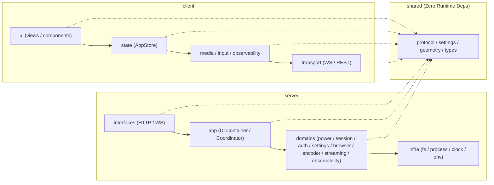
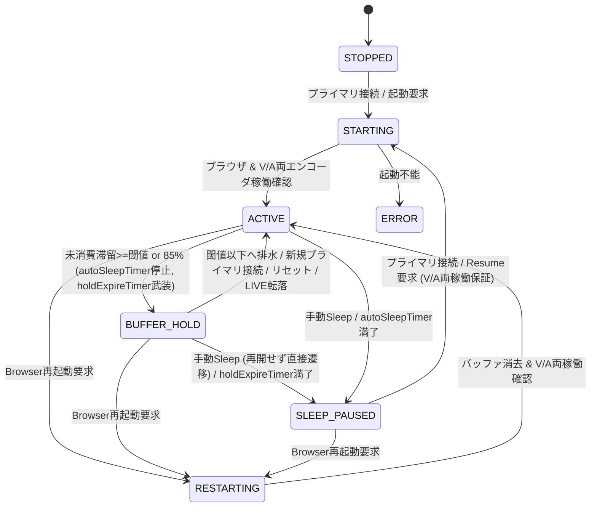
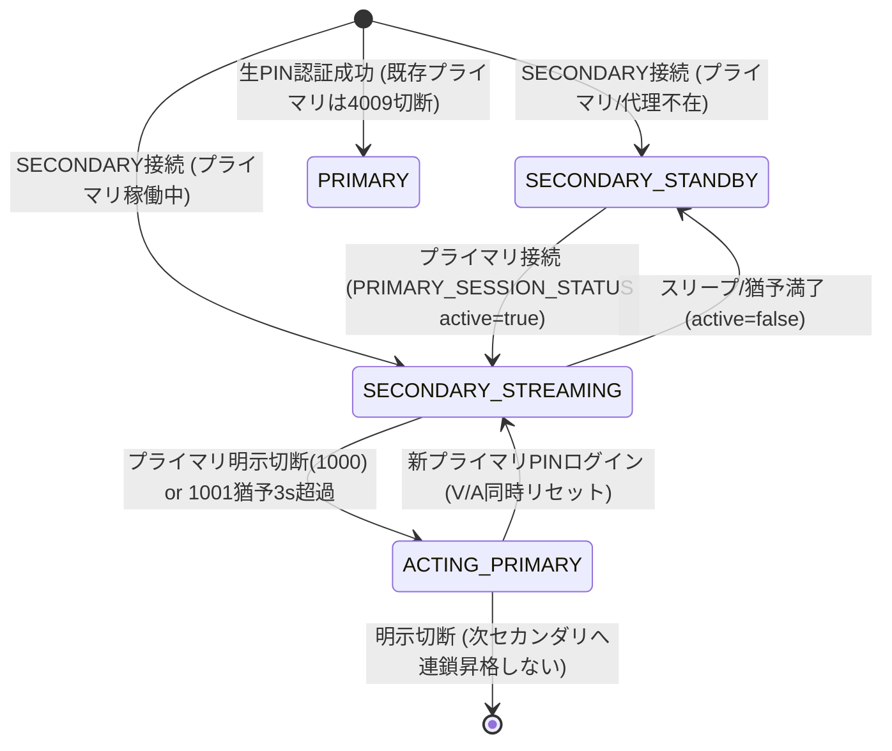
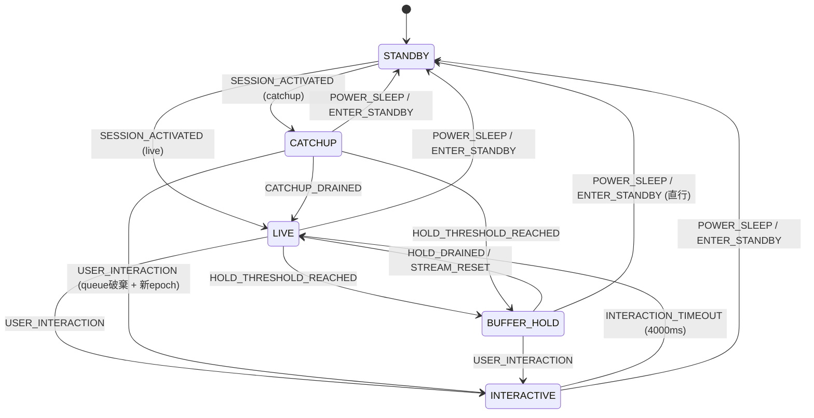

# Tesroid アーキテクチャ設計書 (`docs/architecture.md`)

> 本書は [docs/specs/](specs/) に定義された 10 本の確定仕様書（01〜10）のみを根拠として策定したクリーンリスタート版の設計正典である。

---

## 1. 技術スタック・ディレクトリ構成・レイヤー設計

### 1.1 技術スタック

| 領域 | 採用技術 | 採用理由・仕様上の根拠 |
| :--- | :--- | :--- |
| **ランタイム / 言語** | Node.js 22 LTS / TypeScript (`strict: true`) | ビルド・サーバーランタイム・CI を Node.js 22 LTS に統一（[仕様書 09](specs/09-deploy-infra.md)）。型安全により境界契約の破壊をコンパイル時に検出する |
| **ワークスペース構成** | npm workspaces (`shared`, `server`, `client`) | バイナリプロトコル・設定定義・純粋計算を `shared` に一元化し、クライアント/サーバー間の二重定義と乖離を構造的に防ぐ |
| **品質ツール** | Biome (lint / format) + `tsc --noEmit` + Vitest | 単一ツールチェーンによる高速な静的検査・整形・振る舞いテストを実行し、CI ゲートへ直結する |
| **バックエンド HTTP/WS** | Fastify + 単一多重化 WebSocket (`/ws`, `TCP_NODELAY`) | 映像・音声・制御・タッチ・リサイズ・メトリクス・テレメトリを単一 WSS 接続上で低遅延多重化する（[仕様書 03](specs/03-streaming-transport.md)） |
| **仮想ブラウザ / 入力** | Xvfb + Openbox + PulseAudio UNIX ソケット + Google Chrome + CDP (`127.0.0.1:9222`) | VAAPI 動画デコード + CPU 2D ラスターのハイブリッド描画と、Blink ネイティブタッチ注入を両立する（[仕様書 06](specs/06-browser-input-cdp.md)） |
| **メディアエンコード** | FFmpeg (`h264_nvenc` / VAAPI `radeonsi`/`iHD`/`i965`/`d3d12` / `libx264`) + `libopus` | サーバー側で Annex-B→AVCC 変換と OggOpus パースを完結させ、クライアントを軽量化する（[仕様書 05](specs/05-encoder-gpu.md)） |
| **クライアント再生・UI** | Vanilla TypeScript + Vite + WebCodecs (`VideoDecoder` / `AudioDecoder`) + `<canvas>` 2D (`desynchronized: true`) + Web Audio API (`latencyHint: 'interactive'`) | テスラ車載 OS の走行時 `<video>` 停止ガードを回避し、小窓表示（`773×553 CSS` 基準・DPR 非ハードコード）を主対象とした軽量タッチ専用 UI を構築する（[仕様書 04](specs/04-client-playback-avsync.md), [仕様書 07](specs/07-ui-hud-settings.md)） |
| **コンテナ・公開基盤** | Ubuntu 24.04 (`linux/amd64`) + `tini` + `no-systemd` APT Pinning (`dbus-x11`) + `INSTALL_CHROME=false` + 内蔵 `cloudflared` | ホスト Linux カーネル非依存性と Chrome 再配布規約遵守を両立し、ポート開放不要の HTTPS/WSS 公開を可能にする（[仕様書 09](specs/09-deploy-infra.md)） |

### 1.2 ディレクトリ構成

```text
Tesroid/
├── AGENTS.md                        # AI エージェント開発規約・絶対厳禁事項
├── LICENSE / THIRD_PARTY_NOTICES.md # ライセンス・サードパーティ通知
├── README.md                        # プロジェクト概要
├── package.json                     # ルート npm workspaces 設定・共通スクリプト
├── biome.json                       # Biome リント・フォーマット設定
├── Dockerfile                       # linux/amd64 単一コンテナ定義 (INSTALL_CHROME 引数制御)
├── docker-compose*.yml              # 標準 / prebuilt / Windows(d3d12) / NVIDIA(NVENC) 4系統
├── docker/
│   └── entrypoint.sh                # Chrome 初回検証導入・cloudflared(トークン秘匿)・ENV 境界
├── scripts/
│   ├── install.sh                   # Linux x86_64 対話導入スクリプト
│   └── pc-proxy.mjs                 # ローカル検証用セキュアコンテキストプロキシ
├── docs/
│   ├── architecture.md              # 本設計書
│   └── specs/                       # 01〜10 確定仕様書群 (唯一の要件正典)
├── shared/                          # [Workspace] 外部ランタイム依存ゼロの共有正典
│   └── src/
│       ├── protocol/                # チャンネルID, バイナリフレーム変換, streamEpoch, 制御JSON型, クローズコード
│       ├── settings/                # 設定スキーマ, 単一既定値, 品質3択/プリセット展開, 検証ロジック
│       ├── geometry/                # レイアウト/エンコード寸法アライメント, 水位ヒステリシス計算
│       ├── state/                   # [Stub-First] ストリーミング状態機械 (判別ユニオン・単一遷移関数・純粋セレクタ)
│       └── types/                   # ライフサイクル状態, セッションロール, メトリクス, テレメトリ型
├── server/                          # [Workspace] バックエンド (Modular Monolith)
│   └── src/
│       ├── infra/                   # OS/IO 抽象 (Clock, Env, 原子的JSON/JSONLストア, 子プロセス・ツリー操作)
│       ├── domains/
│       │   ├── settings/            # settings.json 永続化・初期セットアップ展開
│       │   ├── auth/                # bcrypt PIN 認証・24h トークン管理・10回ロックアウト (lockout.json)
│       │   ├── session/             # PRIMARY / ACTING_PRIMARY / SECONDARY 排他・猶予・基準PTS同期
│       │   ├── browser/             # Xvfb/Openbox/Pulse/Chrome 起動・単一スクリプト注入・CDP 入力
│       │   ├── encoder/             # GPU 検出/フォールバック・H.264 AVCC/OggOpus パーサ・媒体パイプライン
│       │   ├── streaming/           # streaming-controller(単一遷移関数シェル)・リングバッファ・ヒステリシス・CATCHUP・Hold判定
│       │   ├── power/               # 単一ライフサイクル状態機械・排他タイマー・ドメイン間Port定義
│       │   └── observability/       # 360件メトリクス集計・オプトインJSONLテレメトリ(10MiB/15世代)
│       ├── app/                     # DI コンテナ配線 & ストリーム世代/イベント調停 (Coordinator)
│       └── interfaces/              # HTTP REST ルート・認証ミドルウェア・WS ゲートウェイ (/ws)
└── client/                          # [Workspace] フロントエンド (ステートレス・タッチ専用)
    └── src/
        ├── transport/               # WS 自動再接続・バイナリ送受信・REST API クライアント
        ├── media/                   # playback-controller(単一遷移関数シェル)・streamEpochゲート・キュー分離・マスタークロック
        ├── input/                   # 上端20pxガード・スロップ/デバウンス・余白除外座標変換
        ├── observability/           # 10秒差分メトリクス計測・オプトインJSONLバッチ送信
        ├── state/                   # 単方向データフロー AppStore (sessionStorage は token/role のみ)
        └── ui/                      # セットアップ・PIN・状態画面・常設HUD・3タブ設定・省電力/確認モーダル
```

### 1.3 レイヤー設計と依存方向

バックエンドは **Ports & Adapters（クリーンなモジュラーモノリス）** を採用し、ドメインロジックが Fastify や OS プロセス詳細に直接結合することを防ぐ。クライアントは **UI とメディア再生エンジンの厳格分離** により、DOM 操作の都合がデコーダや同期クロックへ波及しない構造とする。



---

## 2. モジュール境界と依存関係のルール

### 2.1 依存関係マトリクス

| モジュール層 | 参照を許可する対象 | 参照を禁止する対象 |
| :--- | :--- | :--- |
| **`shared/*`** | `shared` 内部のみ | `server`, `client`, Node.js 固有 API (`fs`, `child_process`), DOM API |
| **`server/infra`** | Node.js 標準 / 外部ライブラリ, `shared` | `server/domains`, `server/app`, `server/interfaces` |
| **`server/domains/*`** | 同一ドメイン内部, 自身の Port インターフェース, `infra` の最小契約 (`Clock` 等), `shared` | **他ドメインの具象クラス直接参照**, `server/interfaces` (Fastify/WS 型), `server/app` |
| **`server/app`** | `domains/*`, `infra/*`, `shared/*` | `server/interfaces` のリクエスト/レスポンス詳細 |
| **`server/interfaces`** | `app`, ドメイン公開契約/DTO, `shared/*` | `domains` 内部のプライベート状態、`infra` への直接書き込み |
| **`client/transport`** | ブラウザ通信 API (`fetch`, `WebSocket`), `shared/*` | `client/ui`, `client/media`, `localStorage` |
| **`client/media`, `input`, `observability`** | WebCodecs / Canvas / WebAudio / DOM Pointer, `transport` Port, `shared/*` | `client/ui` の DOM コンポーネント, `localStorage`, `<video>` |
| **`client/state`** | `transport`, `media`/`input`/`observability` 制御面, `shared/*`, `sessionStorage` | `localStorage`, 生の HTML テンプレート構築 |
| **`client/ui`** | `state`, `shared/settings` (表示メタデータ), DOM API | `transport` 生ソケット、`media` キュー/デコーダ内部、`window.prompt`/`confirm`、`<video>` |

### 2.2 変更波及を防ぐ 8 つの構造的境界ルール

1. **単一電源・ライフサイクル権威 (`domains/power`)**:
   - 稼働状態（`STOPPED | STARTING | ACTIVE | BUFFER_HOLD | SLEEP_PAUSED | RESTARTING | ERROR`）およびタイマー排他制御（`autoSleepTimer` XOR `holdExpireTimer`）は `domains/power` が唯一所有する。
   - 仮想ブラウザ、エンコーダ、ストリーミング転送はそれぞれ狭い **Port**（`PowerBrowserPort`, `PowerEncoderPort`, `PowerStreamingPort`, `PowerSessionPort`）を実装するのみとし、独自にスリープ状態や電源タイマーを持たない。
2. **単一配信権威とセカンダリ完全分離 (`domains/session` & `domains/streaming`)**:
   - 配信基準・リサイズ・配信リセット・バックプレッシャー・Buffer-Hold 発動判定の権威は常に単一の `PRIMARY`（不在時のみ 1 台の `ACTING_PRIMARY`）に限定する。
   - セカンダリ（`SECONDARY_STREAMING` / `SECONDARY_STANDBY`）への送出キューと輻輳スキップはソケット単位で独立させ、セカンダリの回線遅延・切断がプライマリおよびエンコーダ稼働へ一切波及しない構造とする。
3. **ストリーム世代 ID (`streamEpoch`) による境界隔離 (`shared` / `encoder` / `streaming` / `client/media`)**:
   - エンコーダ再起動・電源復帰・`POST /api/stream/reset`・寸法変更のたびに単調増加する `UInt32BE` の `streamEpoch` を発行し、全メディアパケット・状態制御へ付与する。
   - 旧世代パケットや旧デコーダの非同期出力は `streamEpoch` 不一致で構造的に即時破棄するため、モジュールを跨ぐ複雑な PTS 比較・後付けストラグラーバリアを不要とする。
   - `POST /api/stream/reset` は「健全 LIVE 時のスキップ分岐」を持たず、常に V/A 両エンコーダとクライアント両デコーダをリセットする単一経路に固定する。
4. **単一設定正典 & ステートレスクライアント (`shared/settings` & `domains/settings`)**:
   - 全設定項目の型・既定値・許容境界・品質 3 択/負荷プロファイル展開ロジックを `shared/settings` へ集約し、永続化はサーバー `settings.json` のみに限定する。
   - クライアントは `localStorage` へ設定を保存せず、接続時および更新時にサーバーから受け取ることで設定不整合を根絶する。
5. **ブラウザスクリプト単一注入元 (`domains/browser/page-scripts.ts`)**:
   - WebAuthn 抑止、表示拡大率（`[50, 250]%`, 既定 `100%`）、仮想 Web フルスクリーン、動画サイト音量 `100%` 固定の注入コードおよびパラメータ検証を 1 モジュールへ集約し、二重注入やフォールバック値乖離を防ぐ。
6. **キュー分離 & 単一マスタークロック同期 (`client/media`)**:
   - リアルタイム描画用 `LIVE` キューと通信断追っかけ用 `CATCHUP` キュー（最大 `30s` / `48 MiB`）を明確に分離し、通常視聴時の不要な先読み滞留を発生させない。
   - 音ズレ同期は「プライマリ音声実再生時刻（セカンダリは鮮度 `5s` 未満のプライマリ基準 PTS）」を唯一マスタークロックとし、個別の閾値特例パッチを持たない統一評価ループで処理する。音声再生速度は常時 `1.0x` 固定とする。
7. **ストリーミング状態のカプセル化と単一遷移関数集約（Stub-First & No Boolean Soup）**:
   - `STANDBY` / `INTERACTIVE` / `LIVE` / `CATCHUP` / `BUFFER_HOLD` の配信・視聴状態を複数の独立 boolean フラグ（`isLive`, `isCatchup`, `isStandby`, `isInteractive`, `isHolding` 等）で表現することを禁止し、不正な組み合わせを型レベルで表現不能にする排他的判別ユニオン `StreamingState` へカプセル化する。
   - すべての状態遷移は `shared/src/state/streaming-fsm.ts` の **単一純粋遷移関数 `transitionStreamingState(state, event)`** に集約し、呼び出し元（`streaming-controller` / `playback-controller`）はイベント投入と返却された宣言的 `effects` の実行のみを担う。
   - 実装時は Phase 1 で状態・イベント・副作用・`assertNever` 網羅性チェック付きスタブを先行作成し、状態依存の振る舞い（キュー選択、入力許可、HUD 表示）は散在 `if` 分岐ではなく純粋セレクタ経由でのみ参照する。
8. **小窓表示主対象 & DPR 非ハードコード境界 (`shared/geometry` / `client/input` / `client/ui` / `server/encoder`)**:
   - 実車利用の中心であるナビ等と並べた小窓表示（代表基準 `773×553 CSS / DPR 1.53`）を主対象として、UI 視認性およびエンコード解像度を最適化する（全画面表示にも追従）。
   - 将来のファームウェア更新で DPR が変化し得るため、`1.53` 等の特定 DPR 値を UI・CSS・設定・計算式へ直書きしてはならず、クライアントの実行時物理ピクセル（`devicePixelRatio`）および `shared/src/geometry` を単一正典とするサーバー側リサイズ計算で吸収する。

### 2.3 ドメイン間 Port 契約一覧

| Port 名 | 提供側 / 利用側 | 主な責務契約 |
| :--- | :--- | :--- |
| **`Clock`** | `infra` → 全ドメイン | `nowMs()`, `monotonicMs()`, `setTimeout` / `clearTimeout` 抽象（タイマー検証を決定論化） |
| **`SettingsRepository`** | `domains/settings` → `app` / `auth` / `encoder` / `browser` / `power` | 読み込み、原子的保存、お気に入り検証、変更通知購読 |
| **`PowerBrowserPort`** | `domains/browser` → `domains/power` | `freezeTree()` (`SIGSTOP` 子→親), `resumeTree()` (`SIGCONT` 親→子), `restartBrowser()`, `setMonitoringPaused(bool)` |
| **`PowerEncoderPort`** | `domains/encoder` → `domains/power` | `ensureDualRunning()` (V/A 片肺防止保証), `stopAll()`, `advanceEpochAndResetClock()`, `pauseWithTimelineComp()`, `clearTimelineComp()` |
| **`PowerStreamingPort`** | `domains/streaming` → `domains/power` | `clearBufferAndQueues()`, `broadcastPowerState(state, epoch)` |
| **`PowerSessionPort`** | `domains/session` → `domains/power` | プライマリ有無・代理有無の照会、`demoteAllStreamingToStandby()`, `promoteStandbyToStreaming()` |

---

## 3. データモデル / 状態管理の方針

### 3.1 サーバー永続データ (`/data`)

すべての永続データはコンテナの `/data` ボリューム配下に限定し、JSON ファイルは「一時ファイル書き込み + `fsync` + `rename`」による原子的更新を行う。

| ファイル / ストア | 保持データ | 不変条件・障害時挙動 |
| :--- | :--- | :--- |
| **`settings.json`** | `isSetupCompleted`, `pinHash` (bcrypt cost 10), `timezone` (既定 `Asia/Tokyo`), `stream` (`fps`, `videoBitrate`, `audioBitrate`, `maxSize`, `preset`, `x264Preset`, `clientProfile`, `displayScale`, `targetBufferMs`, `autoSleepMinutes`, `telemetryEnabled`), `favorites` (`id`, `title`, `url`, `isHome`, 最大 100 件) | `pinHash` 以外の平文 PIN は保持しない。URL 重複を全経路で拒否。JSON 破損起動時は初期未セットアップ規定値へ安全フォールバックする |
| **`lockout.json`** | `consecutiveFailures` (`0..10`), `isLocked`, `lastFailureAt` | PIN 検証失敗ごとに即時永続化。`10` 回到達時は永続化 → 全 WS へコード `1008` 送出 → `200 ms` 後 `exit 1`。起動時 `isLocked \|\| consecutiveFailures >= 10` なら即時 `exit 1` |
| **`telemetry/*.jsonl`** | 許可種別 (`av_sync`, `buffering`, `decoder`, `pacer`, `audio`, `network`, `log`) のイベント行 | `telemetryEnabled === false` 時は I/O ゼロ。最初の有効イベント到着時に遅延作成（`session-YYYYMMDD-HHMMSS-<rand>`）。1 ファイル上限 `10 MiB`、最大 `15` セッションローテーション、直列書き込みキュー、ID サニタイズ |

### 3.2 サーバー揮発状態（インメモリ）

- **`SessionTokenStore`**: 暗号学的ランダム 32 バイト（64 hex 文字）、TTL `24 時間 (86,400,000 ms)`、`10 分` 周期掃討。サーバー再起動または PIN 更新時に全失効。
- **`SessionRegistry`**: 接続ソケットとロール（`PRIMARY`, `ACTING_PRIMARY`, `SECONDARY_STREAMING`, `SECONDARY_STANDBY`）、リロード `3,000 ms` 昇格猶予タイマー、プライマリ確認済み PTS・再生モードメタデータを保持。
- **`LifecycleMachine` & `PowerTimers`**: 単一電源状態と排他タイマー（`autoSleepTimer` と `holdExpireTimer` は絶対同時稼働不可、`autoSleepMinutes = 0` 下でも `BUFFER_HOLD` 中のプライマリ切断時は `holdExpireTimer` を再武装）。
- **`RingBuffer`**: 最大 `60 秒` / `48 MiB`、映像 `CONFIG` 別スロット保持、上限超過時は最古の完全 GOP と先行音声のみ破棄（最新進行中 GOP は保護）。
- **`MetricsRingBuffer`**: `360` エントリ（10 秒間隔 × 1 時間）の純粋な差分ウィンドウ集計。

### 3.3 クライアント状態管理

- **永続ストレージ方針**: `localStorage` は **完全廃止**（コード上の読み書き禁止）。タブ内リロード・瞬断復帰に必要な `token` と `role` のみを `sessionStorage` に保持する。
- **表示ターゲットと DPR 非ハードコード**: UI レイアウト・視認性およびエンコード解像度は実車中心の小窓表示（`773×553 CSS` 基準）を主対象としつつ、`1.53` 等の DPR 値は直書きせず実行時物理ピクセルとサーバー側リサイズ計算で動的に吸収する。
- **単方向状態管理 (`AppStore`)**:
  - `route`: `CONNECTING | CONNECTION_ERROR | SETUP | PIN | STREAMING | LOCKED | SUPERSEDED_4000 | CONFLICT_4009`
  - `powerState`: サーバー通知と同期した電源状態（`SECONDARY_STANDBY` 中は電源状態通知で待機オーバーレイを上書きしない）
  - `settings`: サーバー応答成功時のみ更新（`PUT /api/settings` 失敗時は楽観的更新でサーバー状態と乖離させない）
  - `hud`: 排他ドロワー状態（`none | keyboard | favorites`）、自動減光タイマー（`4,000 ms`）、RTT 鮮度状態（`5,000 ms` 超過でリセット）

### 3.4 主要状態遷移図





### 3.5 ストリーミング状態機械の設計契約（スタブ骨格・遷移表・状態図）

旧実装で `LIVE ↔ CATCHUP ↔ STANDBY ↔ INTERACTIVE` の条件分岐が通信・バッファ・入力・UI へ散在した問題を根絶するため、Phase 1 で以下の純粋状態機械スタブを [`shared/src/state/streaming-fsm.ts`](../shared/src/state/streaming-fsm.ts) へ先行定義し、サーバー・クライアント双方の単一遷移正典とする。

#### スタブ骨格（`shared/src/state/streaming-fsm.ts` 設計契約）

```ts
export type StreamingState =
  | { kind: "STANDBY"; streamEpoch: number; reason: "UNAUTHENTICATED" | "REAR_STANDBY" | "SLEEP_PAUSED" }
  | { kind: "INTERACTIVE"; streamEpoch: number; lastInteractionAtMs: number }
  | { kind: "LIVE"; streamEpoch: number }
  | { kind: "CATCHUP"; streamEpoch: number; targetBufferMs: number; resumePtsUs: number }
  | { kind: "BUFFER_HOLD"; streamEpoch: number; holdSinceMs: number; targetBufferMs: number };

export type StreamingEvent =
  | { type: "SESSION_ACTIVATED"; streamEpoch: number; resumeCatchup?: { targetBufferMs: number; resumePtsUs: number } }
  | { type: "ENTER_STANDBY"; reason: "REAR_STANDBY" | "SLEEP_PAUSED" | "UNAUTHENTICATED" }
  | { type: "USER_INTERACTION"; atMs: number; newStreamEpoch: number }
  | { type: "INTERACTION_TIMEOUT" } // 最終操作から 4,000 ms 経過
  | { type: "CATCHUP_DRAINED" }
  | { type: "SOCKET_CONGESTED" }
  | { type: "HOLD_THRESHOLD_REACHED"; atMs: number; targetBufferMs: number }
  | { type: "HOLD_DRAINED"; newStreamEpoch: number }
  | { type: "STREAM_RESET"; newStreamEpoch: number }
  | { type: "POWER_SLEEP" };

export type StreamingEffect =
  | { type: "FLUSH_CATCHUP_QUEUE" }
  | { type: "ADVANCE_EPOCH_AND_RESET"; streamEpoch: number }
  | { type: "ARM_INTERACTION_TIMER"; delayMs: 4000 }
  | { type: "CANCEL_INTERACTION_TIMER" }
  | { type: "REQUEST_POWER_HOLD" }
  | { type: "REQUEST_POWER_RESUME" }
  | { type: "ENTER_LIVE_HYSTERESIS" }
  | { type: "BROADCAST_STATE" };

export interface StreamingTransition {
  nextState: StreamingState;
  effects: readonly StreamingEffect[];
}

export function transitionStreamingState(state: StreamingState, event: StreamingEvent): StreamingTransition {
  // switch (state.kind) + switch (event.type) + assertNever による完全網羅スタブ
}

// 純粋セレクタ群（周辺モジュールは boolean の組み合わせではなくこれのみを参照する）
export const selectQueueKind = (state: StreamingState): "NONE" | "LIVE" | "CATCHUP" => ...;
export const isInputAllowed = (state: StreamingState): boolean => state.kind !== "STANDBY";
export const shouldSuppressMediaSend = (state: StreamingState): boolean =>
  state.kind === "STANDBY" || state.kind === "BUFFER_HOLD";
```

#### 主要 State × Event 遷移マトリクス（不変条件）

| 現在状態 (`state.kind`) | 主な入力イベント | 次状態 (`nextState.kind`) | 宣言的 `effects` / 構造的不変条件 |
| :--- | :--- | :--- | :--- |
| **`STANDBY`** | `SESSION_ACTIVATED` (通常 / 追っかけあり) | `LIVE` or `CATCHUP` | `BROADCAST_STATE`（`STANDBY` 中の操作・輻輳・Hold イベントはすべて無視） |
| **`INTERACTIVE`** | `INTERACTION_TIMEOUT` (`4,000 ms`) | `LIVE` | 音声は止めず単一マスタークロック同期へ移行 |
| **`INTERACTIVE`** | `USER_INTERACTION` | `INTERACTIVE` | `lastInteractionAtMs` 更新 + `ARM_INTERACTION_TIMER(4000)` |
| **`LIVE`** | `SOCKET_CONGESTED` | **`LIVE`（不変）** | `ENTER_LIVE_HYSTERESIS` のみ。**絶対に `CATCHUP` へ遷移しない** |
| **`LIVE`** | `USER_INTERACTION` | `INTERACTIVE` | `ARM_INTERACTION_TIMER(4000)` |
| **`LIVE` / `CATCHUP`** | `HOLD_THRESHOLD_REACHED` | `BUFFER_HOLD` | `CANCEL_INTERACTION_TIMER` + `REQUEST_POWER_HOLD` + `BROADCAST_STATE` |
| **`CATCHUP`** | `CATCHUP_DRAINED` | `LIVE` | `BROADCAST_STATE` |
| **`CATCHUP`** | `USER_INTERACTION` | `INTERACTIVE` | `FLUSH_CATCHUP_QUEUE` + `ADVANCE_EPOCH_AND_RESET` + `ARM_INTERACTION_TIMER(4000)` |
| **`BUFFER_HOLD`** | `HOLD_DRAINED` / `STREAM_RESET` | `LIVE` | `REQUEST_POWER_RESUME` + `ADVANCE_EPOCH_AND_RESET` + `BROADCAST_STATE` |
| **`BUFFER_HOLD`** | `USER_INTERACTION` | `INTERACTIVE` | `FLUSH_CATCHUP_QUEUE` + `REQUEST_POWER_RESUME` + `ADVANCE_EPOCH_AND_RESET` + `ARM_INTERACTION_TIMER(4000)` |
| **`BUFFER_HOLD`** | `POWER_SLEEP` / `ENTER_STANDBY` | `STANDBY` | 再開チャーンを経由せず直接 `STANDBY`（`FLUSH_CATCHUP_QUEUE`） |
| **稼働中全状態** | `STREAM_RESET` | `LIVE` | `FLUSH_CATCHUP_QUEUE` + `ADVANCE_EPOCH_AND_RESET` + `CANCEL_INTERACTION_TIMER` |



---

## 4. テスト戦略（振る舞いベース・最小限・モック非依存）

### 4.1 テスト設計の基本方針

テストは実装構造の鏡像ではなく、**各仕様書の「セクション 5: 受け入れ条件（AC）」の実行可能な仕様** として設計する。内部リファクタリングでテストが壊れないよう、モックの乱用を排し、公開契約（関数入出力・HTTP/WS メッセージ・状態遷移結果）のみを検証する。

### 4.2 テストの 3 階層構造

| 階層 | 対象範囲 | テストダブルの方針 | 主な検証対象（仕様 AC 準拠） |
| :--- | :--- | :--- | :--- |
| **1. 純粋ドメイン・プロトコル単体テスト** | `shared/*`, `server/domains/*` 純粋ロジック, `client/media/sync-clock` 等 | **モック不使用**（タイマー系のみ `Clock` 注入） | `transitionStreamingState` の状態×イベント全組み合わせテーブル駆動テスト、バイナリ往復対称性、`streamEpoch` 旧世代破棄、Annex-B→AVCC(1B分断/AUD欠落)、OggOpus、小窓基準（`773×553 CSS`）・可変 DPR 寸法アライメント、ビットレート連動ヒステリシス、リングバッファ GOP 破棄、リンク認識 CATCHUP、単一マスタークロック 4 秒以内 `\|音ズレ\|<=60ms` 収束・真の符号付きドリフト、電源状態機械・排他タイマー (`autoSleepMinutes=0` 含む)、10 秒差分メトリクス |
| **2. 境界結合テスト** | Fastify HTTP + WS (`/ws`) + ファイル永続化 + Coordinator | **外部 OS 境界の Port のみ Fake**（FFmpeg / Xvfb / Chrome / CDP のみ、他ドメイン間は実オブジェクト結合） | セットアップ `403`/`400`、品質 3 択展開、ロックアウト 10 回→`1008`→起動ガード、PIN 変更時トークン全失効、同一トークン `4000` vs 競合 `4009`、代理昇格/非連鎖/降格同時リセット、後席待機保護、`POST /api/stream/reset`、テレメトリ `512 KiB`/`10 MiB`/`15` 世代/ループバック認証境界 |
| **3. 不変条件ガードレールテスト** | リポジトリ全体・ビルド後 `dist/`・`Dockerfile` | 静的解析・ビルド成果物検査 | ソース/ビルド後 HTML の `<video>` ゼロ・`<canvas>` 存在・小窓基準 HUD 中央揃え、`1.53` 等 DPR ハードコード禁止、`localStorage` 不使用、`window.prompt`/`confirm`/`Escape` 閉じ禁止、禁止 Chrome フラグ非含有、`/etc/libva.conf` 非ハードコード、`no-systemd` Pinning & `dbus-x11`、機密情報ゼロ |

### 4.3 禁止するテストアンチパターン

1. **内部モック・スパイの乱用禁止**: 同一プロセス内のドメインクラスや内部ヘルパー関数を `vi.mock` で差し替えてはならない。Fake にできるのは OS プロセス・ファイルシステム以外の外部境界 Port と `Clock` のみ。
2. **内部実装への過剰結合禁止**: プライベートメソッドの呼び出し順序や内部関数の `toHaveBeenCalledTimes(n)` を検証しない。常に外部から観測可能な応答・状態・出力フレームで検証する。
3. **重複・自明テスト禁止**: TypeScript の型チェックで保証済みの入力型チェックや、上位結合テストと完全に重複する細粒度の同一検証を量産しない。1 つの AC に対し必要最小限の代表ケースのみを保つ。

---

## 5. 実装ロードマップ（依存の少ない土台から段階的に構築）

依存関係のない下位層（`shared`）から、サーバー各ドメイン、クライアント再生エンジン、UI・インフラへと順に積み上げる。各フェーズ完了時に CI ゲート（`check` / `test` / `build`）を通過させる。

| Phase | 対象領域 | 主な成果物 | 依存 | 完了条件（検証対象仕様） |
| :--- | :--- | :--- | :--- | :--- |
| **Phase 0** | **リポジトリ土台 & 品質ゲート** | ルート/`shared`/`server`/`client` `package.json`, `tsconfig.json`, `biome.json`, `vitest.config.ts`, 不変条件ガードレール骨格, `.github/workflows/ci.yml` 整合 | なし | 空スケルトン上で lint / typecheck / test / build が緑で通る |
| **Phase 1** | **`shared` 正典モジュール & 状態遷移スタブ** | `protocol` (`streamEpoch`, バイナリエンコード/デコード, チャンネル/クローズコード), `settings` (スキーマ, 単一既定値, 品質 3 択/負荷プロファイル, 検証), `geometry` (寸法アライメント, 水位式), **`state/streaming-fsm.ts`（排他 5 状態・イベント・副作用・単一遷移関数スタブ＆純粋セレクタ）** | Phase 0 | [仕様書 01](specs/01-auth-security.md), [03](specs/03-streaming-transport.md) (AC-06 含む), [05](specs/05-encoder-gpu.md), [07](specs/07-ui-hud-settings.md) のプロトコル・状態遷移・設定・計算 AC がモックゼロ単体テストで PASS |
| **Phase 2** | **認証・設定永続化・セットアップ** | `infra/storage`, `domains/settings`, `domains/auth` (bcrypt, 24h トークン, `lockout.json` 起動ガード), REST `/api/status`, `/api/setup`, `/api/auth/verify`, `/api/settings` | Phase 1 | [仕様書 01](specs/01-auth-security.md) AC-01〜05（形式・ロックアウト・`403`/`400`・破損フォールバック）が実 HTTP 結合テストで PASS |
| **Phase 3** | **セッション管理 & 単一電源状態機械** | `domains/session` (`PRIMARY`/`ACTING_PRIMARY`/`SECONDARY_*`, 3s 猶予, 非連鎖), `domains/power` (単一 FSM, 排他タイマー, Port 契約), WS 認証/ロール制御, `/api/power/*` | Phase 2 | [仕様書 02](specs/02-session-multidisplay.md) AC-01〜06 & [仕様書 10](specs/10-power-lifecycle.md) AC-01〜04 が Clock 注入 + Port Fake 結合テストで PASS |
| **Phase 4** | **仮想ブラウザ & CDP 入力** | `domains/browser` (PulseAudio/Xvfb/Openbox/Chrome 起動引数・環境構築, 単一 `page-scripts.ts`, `SIGSTOP`/`SIGCONT` ツリー, CDP ネイティブ入力専用, URL 監視) | Phase 3 | [仕様書 06](specs/06-browser-input-cdp.md) AC-01〜05（禁止フラグ不在・WebAuthn/バブル抑止・ズーム `[50,250]`・YouTube フルスクリーン・プロセス順序）が PASS |
| **Phase 5** | **マルチ GPU エンコーダ & 統合ストリーミング** | `domains/encoder` (NVENC→AMD→Intel→Software 検出・フォールバック, Annex-B→AVCC/OggOpus, マスタークロック + ウォッチドッグ), `domains/streaming` (`streaming-controller` による単一遷移関数駆動・副作用実行, 60s/48MiB リングバッファ, ビットレート連動ヒステリシス, リンク認識 CATCHUP, Hold 連動), `POST /api/stream/reset` | Phase 4 | [仕様書 05](specs/05-encoder-gpu.md) AC-01〜04 & [仕様書 03](specs/03-streaming-transport.md) AC-01〜06 が PASS |
| **Phase 6** | **観測性基盤（メトリクス & テレメトリ）** | `domains/observability` (360 件集計, 10 秒差分, 遅延 JSONL 10 MiB / 15 世代, ループバック免除ミドルウェア), `/api/health`, `/api/metrics/*`, `/api/telemetry/*` | Phase 5 | [仕様書 08](specs/08-observability.md) AC-01〜04 が PASS |
| **Phase 7** | **クライアント再生エンジン & タッチ前処理** | `client/transport`, `client/media` (`playback-controller` による単一遷移関数駆動, `streamEpoch` ゲート, LIVE/CATCHUP キュー分離, 単一マスタークロック同期, `<canvas desynchronized>`, Web Audio `1.0x` + 40ms 保護), `client/input` (20px 上端ガード/スロップ/余白除外), `client/observability` | Phase 1, 6 | [仕様書 04](specs/04-client-playback-avsync.md) AC-01〜05（4 秒以内収束・GPU 解放 100%・真のドリフト）& [仕様書 06](specs/06-browser-input-cdp.md) AC-02 クライアント側が PASS |
| **Phase 8** | **車載 UI & コンテナ/CI 完成** | `client/state` & `client/ui` (2 段ウィザード, PIN/4000/4009/ロックアウト画面, 常設 HUD, 相互排他ドロワー, YouTube 限定検索バー, 3 タブ設定, アプリ内モーダル統一), `Dockerfile`, Compose 4 系統, `entrypoint.sh`, `install.sh`, `pc-proxy.mjs` | Phase 7 | [仕様書 07](specs/07-ui-hud-settings.md) AC-01〜05 & [仕様書 09](specs/09-deploy-infra.md) AC-01〜05 & ビルド後 DOM 検証が全 PASS |
