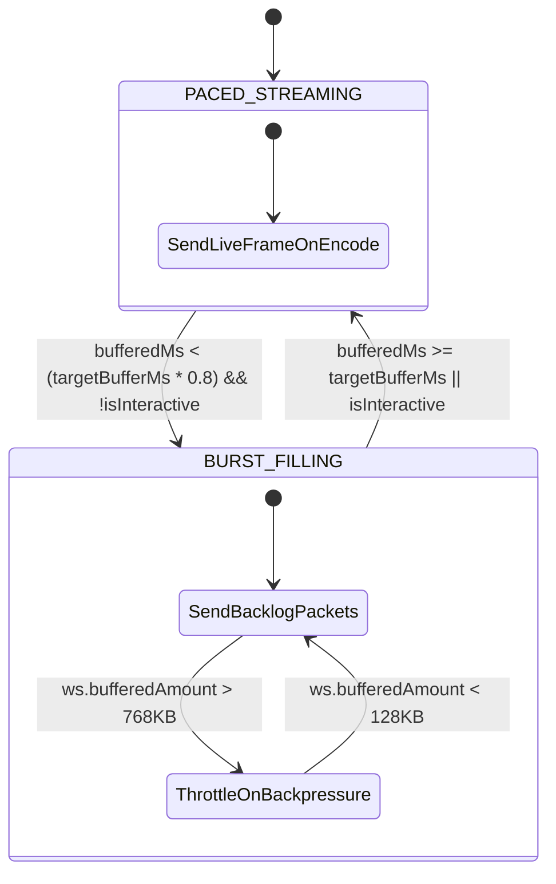
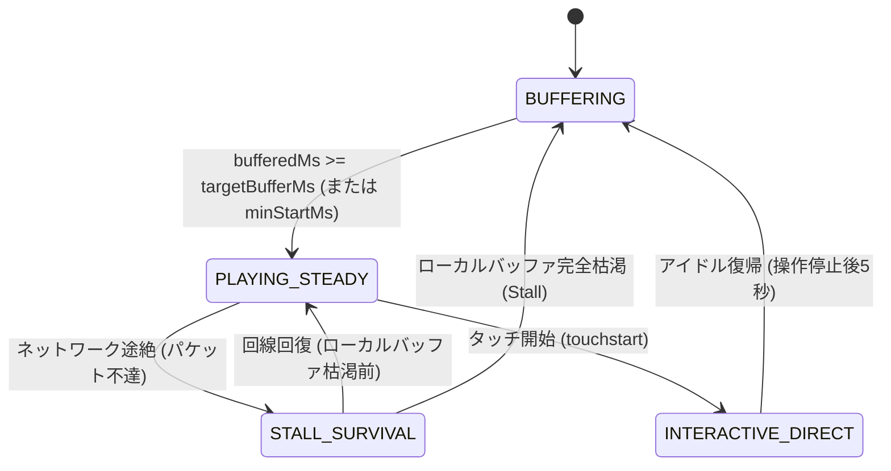

# クライアント先行バッファリング & 動的バースト同期 設計仕様書
(Client Prefetch Buffer & Dynamic Burst Synchronization Specification)

## 1. エグゼクティブサマリー & 実現可能性評価 (Feasibility Study)

### 1.1 背景と目的
テスラ車載ブラウザ（Model 3/Y/S/X）における LTE / Wi-Fi 通信では、トンネル、高架下、基地局ハンドオーバーに伴う **1〜5秒程度のパケット途絶・瞬断** が頻繁に発生します。
本機能は、**「サーバー側キャッシュ + クライアント側先行バッファ（最大10秒）の二重化構造」** と **「回線回復時の動的バースト充電（Prefill / Catch-up）」** を導入し、瞬断時でも映像・音声が一切停止しない超堅牢なストリーミングを実現します。
また、将来的な **Intel Atom（MCU2）などメモリが厳しい車両への適用** を想定し、バッファ深度を可変調整可能とします。

---

### 1.2 実現可能性の検証 (Feasibility Verification)

| 検討項目 | 課題・懸念事項 | 評価結果 & 解決策 |
| :--- | :--- | :--- |
| **クライアント側メモリフットプリント** | 10秒分のフレームを保持すると V8 ヒープやテスラ車載ブラウザ（RAM 制限）を圧迫しないか？ | **【極めて安全 (実現可能)】**<br>非圧縮の `VideoFrame` ではなく、**デコード前の圧縮バイナリ（H.264 Annex-B NALU / Opus パケット）で保持** する。<br>1000kbps 映像 + 128kbps 音声の場合、10秒分でも **約 1.41 MB**、2秒分（Intel向け）なら **約 282 KB**。<br>ブラウザプロセスのメモリ制限（数百MB）に対して十分に小さく、GC 圧迫やクラッシュのリスクは皆無。 |
| **ハードウェアデコーダ負荷** | 10秒分のフレームを一気にデコードすると GPU/デコーダプールが枯渇・過負荷にならないか？ | **【負荷ゼロ増 (実現可能)】**<br>既存の `VideoStreamDecoder` にある `maxActiveFrames = 14` の枠内でのみデコードし、描画直前（JIT）に供給する。<br>ハードウェアデコーダは常に 30fps 等速で動作するため、Intel Atom でも GPU 負荷は通常時と全く同じ。 |
| **A/V 同期（音ズレ）** | バースト受信時やバッファ再生時に音ズレが発生しないか？ | **【完全同期維持 (実現可能)】**<br>現在実装されている `AvSyncController` は Web Audio API の `audioContext.currentTime` をマスタークロックとして映像描画時刻を補正する機構を持つ。<br>音声パケットも同様にキューイングし、再生時にタイムスタンプ同期を適用することで音ズレはゼロを維持できる。 |
| **回線帯域とバースト充電時間** | モバイル回線で 10秒分のバッファを迅速にダウンロードできるか？ | **【高速充電可能 (実現可能)】**<br>10秒分のデータ量は約 1.4 MB (11.2 Mbit)。<br>LTE 回線の実効速度が 15 Mbps の場合、**約 0.75 秒で 10秒分のバッファ充填が完了** する。<br>トンネルを出た直後のわずかな通信で次の瞬断に対する耐性を即座に再構築可能。 |
| **操作遅延とのトレードオフ** | 10秒のバッファがあるとタッチ操作が 10秒 遅れてしまうのではないか？ | **【ハイブリッドモードで解決 (実現可能)】**<br>画面タップ検出時にクライアント側キューを最新PTSへ瞬時にパージ（ゼロ遅延ジャンプ）し、操作終了後にバックグラウンドでバースト充電を再開するステートマシンを構築。 |

---

## 2. クライアント・サーバー同期アーキテクチャ設計 (Sync Architecture)

### 2.1 全体構造図

```text
[ Server: tesroid-server ]
  ┌─────────────────────────────────────────────────────────────┐
  │  FFmpeg VAAPI Encoder (30fps / 1000kbps H.264 + 128k Opus)   │
  └──────────────────────────────┬──────────────────────────────┘
                                 ▼
  ┌─────────────────────────────────────────────────────────────┐
  │  PlaybackBuffer (Ring Buffer: 過去60秒保持)                  │
  └──────────────┬──────────────────────────────┬───────────────┘
                 │ (通常等速配信)                │ (未送信バースト送出)
                 ▼                              ▼
  ┌─────────────────────────────────────────────────────────────┐
  │  WebSocketHandler (Rate Controller / Flow Control)           │
  └──────────────────────────────┬──────────────────────────────┘
                                 │
                   WSS (Binary 0x01/0x02 + JSON Feedback)
                                 │
[ Client: Tesla Browser ]        ▼
  ┌─────────────────────────────────────────────────────────────┐
  │  Pre-decode Compressed Queue (Max 2s〜10s / Configurable)   │
  │  - Pending Video Packets (H.264 NALUs)                      │
  │  - Pending Audio Packets (Opus)                             │
  └──────────────┬──────────────────────────────┬───────────────┘
                 ▼ (JIT Decode: max 14 frames)   ▼ (JIT Decode)
  ┌──────────────────────────────┐┌─────────────────────────────┐
  │  VideoStreamDecoder          ││  AudioPlayer (Web Audio)     │
  └──────────────┬───────────────┘└─────────────┬───────────────┘
                 ▼                              ▼
  ┌──────────────────────────────┐              │
  │  FramePacer (1.0x PTS Paced) │<─────────────┘ (Master Clock)
  │  -> CanvasRenderer           │
  └──────────────────────────────┘
```

---

### 2.2 同期・フロー制御プロトコル設計

双方向の通信において、クライアントのバッファ蓄積状態と再生進行度を正確にサーバーへ共有します。

#### ① クライアント ➔ サーバー: `BUFFER_FEEDBACK` (定期またはイベント駆動)
- 送信契機: 500ms 周期、またはタッチ操作開始/終了時、またはバッファ枯渇/満タン時。

```typescript
export interface BufferFeedbackMessage {
  type: 'BUFFER_FEEDBACK';
  bufferedMs: number;        // クライアント側ローカルバッファ残量 (ms)
  targetBufferMs: number;    // 設定された目標バッファ量 (例: 2000, 5000, 10000)
  lastRenderedPts: string;   // 実際に画面描画された最新 PTS (マイクロ秒, BigInt文字列)
  isInteractive: boolean;    // タッチ操作中フラグ (true: ゼロ遅延優先, false: バッファ優先)
  stallCount: number;        // バッファ枯渇発生回数
}
```

#### ② サーバー側の送出レート制御 (State Machine on Server)

サーバーは `BUFFER_FEEDBACK` を受けて、接続セッションの送出モードを動的に切り替えます：



1. **`BURST_FILLING` (急速充電モード)**:
   - クライアントの `bufferedMs` が目標値未満（例: 80%未満）かつ非操作時の場合。
   - `PlaybackBuffer` 内の `lastRenderedPts` 以降の未送信フレームを、WebSocket の送信バッファ（`ws.bufferedAmount`）が High-Water Mark（768KB）に達するまで連続送信する。
2. **`PACED_STREAMING` (等速維持モード)**:
   - クライアントの `bufferedMs` が目標値（`targetBufferMs`）に達した場合。
   - 新規にエンコードされたフレームのみを 1.0x リアルタイム周期（30fps）で送信する。
3. **`INTERACTIVE_ZERO_LATENCY` (低遅延操作モード)**:
   - クライアントが画面操作中の場合。
   - バースト送出を即時停止し、最新のキーフレーム＋現在フレームのみを最小遅延で送信する。

---

### 2.3 クライアント側ステートマシン設計



1. **`BUFFERING` (初期充填 / 復帰充電)**:
   - サーバーから送られてくるパケットをデコード前キュー（`pendingPackets` / 音声キュー）に蓄積。
   - 最小開始基準（例: `targetBufferMs * 0.5`）に達するまで描画を一時ホールド（初回接続時）または等速再生を維持しながら充電。
2. **`PLAYING_STEADY` (安定再生)**:
   - `FramePacer` は 1.0x PTS ペースで描画。
   - バーストで受信した未来フレームはキューに貯まり、目標値（最大10秒）を維持。
3. **`STALL_SURVIVAL` (瞬断耐性動作)**:
   - 通信が途絶（WebSocket 切断または受信停止）しても、クライアントはローカルバッファから厳格に 1.0x ペースで描画・発音を継続。
   - **最大10秒（Intelなら最大2秒）以内の瞬断であれば、画面は 1ミリ秒も止まらない**。
4. **`INTERACTIVE_DIRECT` (操作時ゼロ遅延ジャンプ)**:
   - タッチイベント発生時、ローカルの `pendingPackets` および `FramePacer` 内の古いキューを一括破棄（パージ）。
   - 最新の画面状態に瞬時に同期し、リモート操作のレスポンス性を確保。

---

## 3. 車載 MCU 世代別設定 & メモリガード設計

### 3.1 プリセット仕様

設定モーダルに以下のバッファ深度プリセットを提供します：

| プリセット名 | 目標バッファ (`targetBufferMs`) | メモリフットプリント | 推奨車両・利用シーン |
| :--- | :--- | :--- | :--- |
| **超低遅延 (Zero-Latency)** | 100 ms | 約 15 KB | ゲーム操作、頻繁なリモートデスクトップ操作 |
| **軽量 (Intel / MCU2)** | 2,000 ms (2秒) | 約 280 KB | Intel Atom 搭載車、ブラウザメモリ節約時 |
| **標準 (Standard)** | 5,000 ms (5秒) | 約 705 KB | 一般的な車載走行（高速道路・市街地） |
| **最大 (Ryzen / MCU3)** | 10,000 ms (10秒) | 約 1.41 MB | 長大トンネル通過時、YouTube等の安定視聴 |

※ クライアント URL のクエリパラメータ `?buffer=2s`, `?buffer=10s` でも動的に指定可能。

### 3.2 メモリ上限セーフガード (Client OOM Guard)
- 各プリセットに対して `maxBufferBytes`（例: 10秒時は 3.0MB）を設定。
- 高ビットレート映像が流れてメモリ上限に達した場合、時間（秒数）ではなくバイト数上限を優先し、最古の未デコードフレームを安全に破棄する。

---

## 4. 実装計画 (Implementation Roadmap)

本機能の実装を 4 つのフェーズに分割して進めます。

### フェーズ 1: クライアント側プレバッファキュー拡張 & 1.0x PTS Pacing (Client Core)
- **対象ファイル**:
  - `client/src/core/decoder.ts`
  - `client/src/core/frame-pacer.ts`
  - `client/src/core/audio-player.ts`
- **作業内容**:
  1. `VideoStreamDecoder` の `pendingPackets` を拡張し、指定秒数/バイト数（最大10秒）の保持を正式サポート。
  2. `FramePacer` の描画完了通知と連動した JIT デコードパイプラインの安定化。
  3. `AudioPlayer` の `overflowQueue` と Web Audio API スケジューリングの連携強化。
  4. クライアント単体でのバーストパケット供給時の 1.0x 等速再生テスト。

### フェーズ 2: クライアント・サーバー間同期プロトコル & サーバーバースト送出 (Protocol & Server)
- **対象ファイル**:
  - `server/src/ws/protocol.ts`
  - `server/src/ws/handler.ts`
  - `server/src/encoder/playback-buffer.ts`
  - `client/src/transport/protocol.ts`
  - `client/src/transport/websocket.ts`
- **作業内容**:
  1. `BUFFER_FEEDBACK` メッセージ（0x15 または Control JSON）の定義とハンドラ実装。
  2. `WebSocketHandler` における `BURST_FILLING` ⇄ `PACED_STREAMING` 送出制御ループの実装。
  3. WebSocket バックプレッシャー（High: 768KB / Low: 128KB）と協調したノンブロッキングバースト送出。

### フェーズ 3: インタラクション即時パージ & アイドル再充電ステートマシン (Interaction Logic)
- **対象ファイル**:
  - `client/src/views/streaming.ts`
  - `client/src/input/touch.ts`
  - `server/src/ws/handler.ts`
- **作業内容**:
  1. タッチ操作時のクライアント側キュー即時パージ（ゼロ遅延ジャンプ）処理。
  2. 操作停止から 5秒後のバックグラウンド再充電（Prefill Request）トリガー。
  3. 急激なモード遷移時の A/V リセットとキーフレーム要求ハンドリング。

### フェーズ 4: 設定 UI、HUD インジケータ、回線瞬断シミュレーション検証 (UI & Validation)
- **対象ファイル**:
  - `client/src/views/settings-modal.ts`
  - `client/src/views/streaming.ts` (HUD)
  - `server/test/`, `client/test/`
- **作業内容**:
  1. 設定モーダルに「バッファリング深度（0.1s / 2s / 5s / 10s）」セレクタを追加。
  2. HUD に `BUF: 7.2s / 10.0s [BURST]` のようなリアルタイムインジケータを追加。
  3. 回線途絶（3秒〜8秒）を模擬したモックテストを作成し、再生継続性を自動検証。
